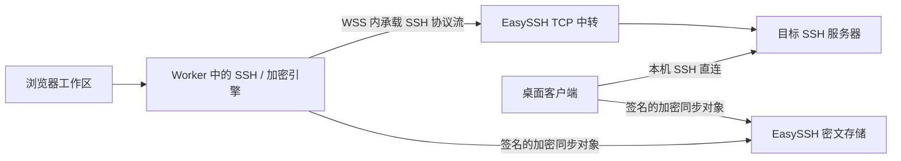

# 客户端加密、浏览器 SSH 与跨端同步

更新日期：2026-10-12。协议版本：5。数据库版本：2。

本次源码切换和本机 SQLite 迁移已实施。未运行应用构建、自动测试、WASM 实际加载、跨端联通或真实 SSH/SFTP 验收；下文的运行验收清单不表示已通过。README 未修改。

## 已实现的数据路径

浏览器继续使用当前站点，无需扩展、独立前端站点或桌面客户端。每个 SSH 连接由浏览器 Worker 中的 Go WASM 引擎完成握手、主机密钥核验、认证、终端、SFTP、监控和 Docker 操作。EasySSH 后端仅将 WebSocket 字节流中转到允许的 TCP 目标，不终止内层 SSH。

桌面继续在本机直接建立 SSH 连接，通过原生加密引擎和浏览器共享同一套加密同步协议。

SSH 初始版本、算法协商和主机公钥等信息本来就公开；认证秘密、终端输入输出和文件内容由客户端到目标 SSH 主机的内层 SSH 会话保护。

## 同步内容和设备授权

账号认证决定网络接口访问资格；设备加密授权决定能够解密哪些数据。这两种授权分别存在，登录账号不等于已经获得数据密钥。

| 范围 | 内容 | 处理方式 |
| --- | --- | --- |
| 基础配置 config | 服务器名称、分组、标签、地址、用户名、认证方式，脚本，服务器自定义排序 | 客户端加密；Automerge 合并；连接信息、脚本内容和排序冲突需人工选择 |
| 凭据 credentials | 服务器密码、私钥、私钥口令；独立 SSH 密钥库 | 单独授权；凭据绑定具体连接配置；存在冲突时阻止使用 |
| AI 设置 ai_config | 个人提供商、地址、模型、API Key | 单独授权、客户端加密；桌面可执行 AI 请求 |
| 会话 sessions | 用户选择加入的 AI 会话展示历史和附件 | 单独授权；同步展示记录，不恢复执行权限或后台任务 |

桌面已有本地服务器、脚本和凭据继续保留。本地资源需加入当前账号空间；换账号不会自动将另一账号的数据上传。独立 SSH 密钥库和 AI 会话也有明确的加入操作。

服务器配置修改与凭据修改在浏览器作为一个本地事务写入。凭据中的连接绑定与当前目标不一致时，不用于连接。桌面接收远端连接变更时清理旧关联凭据，避免将旧密码发送到新目标。

会话使用一个小型冲突索引，内容和附件按 512 KiB 分块，分块名称由摘要派生并在加密文档内校验。单个会话序列化上限为 48 MiB，单次桌面会话投影上限为 128 MiB。超限会明确失败，不跳过附件后假装成功。

## 不同步的内容

- 实时终端输入输出、正在执行的 shell 进程、SSH socket、实时监控采样和在线状态；这些属于当前设备的连接。
- 正在进行的上传、下载和跨服务器传输任务，以及未保存的临时认证答案。
- 浏览器 SFTP 最近目录缓存；仅放在内存，锁定后清空。
- 本机解锁密码、设备签名私钥和解密私钥、操作系统凭据库根密钥、恢复密钥明文。
- 窗口布局、终端标签页、主题等本地工作区偏好。
- 桌面的本地主机信任库；桌面首次连接必须独立确认指纹。浏览器的已确认指纹存放于加密 config 文档，同账号已授权浏览器可同步，冲突时停止连接。
- 未加入当前同步空间的桌面本地资源。

账号、角色、登录会话、OAuth、邮件通知、部署设置、审计记录和备份管理仍由后端管理，不属于客户端加密业务同步。中转需要看到当前连接的目标 host/port、账号、流量、时间和连接结果；密文同步也暴露对象大小、范围、设备公钥和版本等元数据。

## 加密与锁定

- 同步对象使用 AES-GCM 加密，带上下文绑定和 Ed25519 设备签名。
- 设备授权清单带根签名及授权链校验；密钥通过 age X25519 信封分发给获授权设备。
- 本机解锁密码独立于账号密码，长度 12–1024 字节，通过 Argon2id 保护本地密钥包，不发送给后端。
- 新建空间必须先显示并确认保存恢复密钥，才发布授权清单。恢复密钥以 `easyssh5:` 开头，并携带空间指纹。
- 配对时由已有管理员设备核对空间和设备指纹，选择范围，再授权新设备。管理员授权包含全部范围和设备管理能力。
- 撤销设备会轮换该设备获授权范围的数据密钥；撤销管理员还会轮换管理根密钥。旧副本无法收回；旧代次离线修改需要用户明确确认后重新加密同步。
- 已观察到的对象头及签名祖先链用于检测服务端历史回退；遇到回退停止覆盖本机副本。全新设备仍需要可信的配对/恢复锚点，不能从未见过的历史中证明服务端没有隐瞒最新版本。
- 浏览器使用 IndexedDB 保存密文、本地包裹密钥和公开协议元数据，使用 Web Locks 串行化同账号多标签写入。
- 锁定销毁加密 Worker 和 SSH Worker，清理业务查询、终端和传输缓存，并通知同账号其他标签页锁定。桌面加密调用串行，避免旧实例的异步锁定影响新实例。
- 桌面原有密码、私钥及新增私钥口令继续使用操作系统保护的本地凭据加密。此次改造不等于对整个桌面数据库进行全盘加密。

每账号上限：32 个加密设备，4096 版授权历史，授权历史总量 8 MiB，单清单 512 KiB，单加密对象 8 MiB；后端密文对象累计配额 2 GiB。桌面本地加密状态上限 128 MiB。历史密文没有自动回收，达到容量限制会明确报错。

## 安全边界

**不承诺抵御能够篡改同源 JS/WASM 的恶意服务端。** 用户选择保留当前浏览器站点并放弃独立可信前端或扩展。攻击者控制网页发布体系后，仍可能在下次加载、解锁或使用时窃取客户端明文。HTTPS、CSP、SRI、PWA 缓存不能单独消除这个信任前提。

在运行本次代码的正常后端路径中，数据库和备份仅接收用户业务的密文，后端不持有数据解密密钥，也不执行终端或 SFTP 明文业务。这降低数据库、备份、日志和后端进程被动泄露造成的影响。

设备本身被控制、用户选择了错误的主机指纹、恢复密钥泄露，以及已授权设备保存的旧副本均不由服务端端到端加密解决。桌面 AI 请求仍会将用户选择的上下文发给所配置的 AI 提供商。

## 已移除的服务端能力

移除了旧明文同步 Exchange/Vault 接口、服务端 Automerge worker，以及服务端 SSH、SFTP、监控、Docker、脚本业务、个人 AI 代理、会话执行、批量/定时任务、后台文件暂存和任务队列实现。Web 对旧后台任务及 AI 网络调用在本地拒绝，不回退旧接口。

浏览器内终端、SFTP、监控和 Docker 使用当前设备的 SSH 连接。无人值守后台任务和 Web 服务端 AI 代理停止提供；桌面的本地 AI 和本地执行能力保留。

浏览器文件传输随页面和连接生命周期运行。下载及 ZIP 打包的总内容上限为 256 MiB，文本编辑上限为 8 MiB；上传分块传输。跨服务器复制通过当前浏览器在两条 SSH 连接之间搬运。批量目录操作限制深度 64、项数 10000，不跟随符号链接。取消或失败会清理未提交的临时文件；此前已完成的文件和已创建目录可能保留。

## 本地数据库切换记录

2026-10-12 已将 launcher selection 指向的两份活动 SQLite 库从 1 迁到 2；没有迁移 previous 指向的旧库，也没有覆盖历史备份。

| 项目 | 迁移结果 | 一致性备份 |
| --- | --- | --- |
| 桌面 | 保留 15 台服务器、4 个密钥、5 个脚本、6 个 AI 会话及 AI 配置；新增加密状态、独立密钥映射、私钥口令列，删除旧同步协议字段 | `desktop/EasySSHDesktop/bin/backups/client-encryption-cutover-2026-10-12T09-16-10-513Z/easyssh-desktop.sqlite` |
| 服务端 | 保留账号和控制面数据；创建密文空间/授权清单/对象/头和中转路由表，删除旧业务表和运行参数 | `server/backups/client-encryption-cutover-2026-10-12T09-16-10-513Z/easyssh.db` |

每个备份目录还保存 `selection-before.json`、原有恢复根密钥文件和 `cutover.json`。备份包含旧模型业务数据，仍需妥善保管。旧服务端库有 17 台服务器，与桌面的 15 台不同；未将旧服务端业务自动转换成新加密空间，旧服务端独有的数据保留在这份备份中。

迁移使用写事务，检查 SQLite 完整性和外键，再更新 Goose 版本。桌面业务表的原字段与备份逐字段摘要比对一致。旧版本程序不应再打开已迁移到版本 2 的活动库；需要回退时应停机，使用匹配旧版本的程序及这份完整备份恢复，不能只把版本号改回 1。

仓库提供 SQLite、PostgreSQL 和 MySQL 的版本 2 迁移。后两者未在真实数据库执行。开发环境不保留旧协议兼容；MySQL DDL 不提供事务回滚，重新部署必须先保留需要的数据。

## 构建、部署与首次使用

本次未执行下面的构建或运行操作。

1. 重新构建 Web/WASM、服务端和桌面程序，保持同一协议 5 / 数据库 2 版本。Web 的 `pnpm build` 会先调用 `scripts/build-browser-ssh.mjs` 生成 `ssh.wasm`、`crypto.wasm` 和匹配的 `wasm_exec.js`。Docker 多阶段构建也包含两个 WASM 引擎。不要仅执行 `build:ui` 后忽略 WASM 文件。
2. 在 HTTPS 下发布 Web，正确提供 `.wasm` 的 `application/wasm` MIME，并允许 Worker/WebAssembly 运行。非 localhost 的 SSH 中转要求 WSS。首次支持目标为当前 Chromium/Edge；其他浏览器仍需实机验收。
3. 显式配置允许中转的网络和端口，例如 `SSH_RELAY_NETWORKS=192.168.10.0/24`、`SSH_RELAY_PORTS=22,2222`。默认网络列表为空，浏览器 SSH 中转会拒绝全部目标。请按实际网络选择最小必要范围。
4. 全新部署会初始化版本 2。已有版本 1 需要使用对应新程序的 maintenance migrate；此台机器的活动 SQLite 库已完成迁移。
5. 建议先在拥有现有数据的桌面上登录同步账号、创建加密空间、设置本机解锁密码并离线保存恢复密钥，然后选择本地资源与同步范围。
6. 在 Web 登录同账号，设置浏览器本机解锁密码并生成配对请求。在已有管理员设备核对指纹并授权，再回到 Web 完成配对。
7. 无法获得任何已授权设备时使用恢复密钥恢复。账号密码重置不会恢复或重置数据解密密钥。

`/sync/manifests`、`/sync/objects`、`/sync/heads` 和 `/sync/routes` 是 Web 的新接口；桌面使用对应 `/sync/device/...` 接口。`/auth/ticket` 只接受 SSH 中转及实例备份下载两类 Web 票据，SSH 中转入口为 `/ssh/relay/{server_id}`。

## 验证记录及待运行验收

已执行源码格式整理、OpenAPI 类型生成及 132 个路由操作一致性核对、前端 TypeScript 无输出静态检查、Go 依赖声明整理、本机数据库迁移完整性检查。Go 依赖整理可能下载依赖的测试相关模块，但没有执行测试。

未执行：Go/前端/Docker/WASM 构建、自动测试、真实网络联通、浏览器界面验收、PostgreSQL/MySQL 实际迁移、部署发布。

发布前需要运行验收：两端初次配对和离线修改合并，服务器排序冲突，凭据删除与连接变更，密钥口令认证，设备撤销和恢复，首次及变更主机指纹确认，多标签锁定，SFTP 大文件/取消/跨服务器目录复制，以及页面关闭时的连接和密钥清理。上述项目完成前，不能将本次静态检查结果表述为生产运行验收通过。
